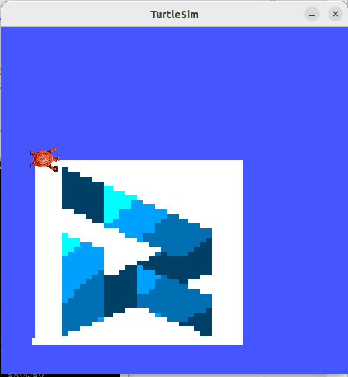
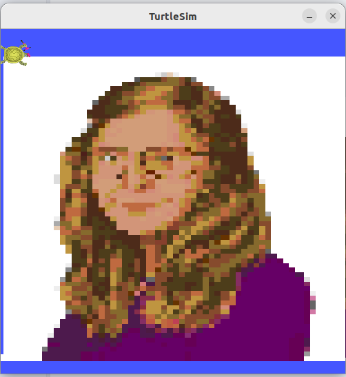

# Menampilkan Gambar Menggunakan ROS2 TurtleSim

**Raihan**

17 Oktober 2026

---
### Ini adalah hasil konversi dari latex menjadi markdown oleh claude.
## Abstract

> Sebuah program ROS2 sederhana yang membaca posisi turtle, kemudian mengirim message melalui topic berupa kecepatan linear dan angular turtle, dengan memanfaatkan dua kombinasi ini maka turtle nantinya akan dapat bergerak dari bawah ke atas sehingga membentuk sebuah gambar pixel-art berukuran tertentu, dengan sumber gambar berupa sebuah vector berukuran 2d yang menyimpan warna RGB untuk setiap pixel.

## 1 Pendahuluan

> Saya tidak bisa menggambar.

Saya rasa itu cukup untuk mewakili keselurahan isi dokumentasi ini. Jadi ketimbang saya menuntun sebuah turtle untuk menggambar lebih baik Saya buat program yang menampilkan sbeuha gmabar yang sudha jadi :) saya rasa tidak ada larangan untuk itu :) Karena jika saya paksa untuk mencoba menggmabar dengan turtle sama saja seperti seorang yang hilang arah menuntun orang lain yang tersesat.

---

## 2 Penjelasan Kode

> Hanya `drawer.cpp` yang akan dijelaskan pada dokumentasi ini. Dan kode berikut hanya akan menampilkan sebuah pixel hitam mengingat limitasi pada didalam *LaTeX*

```cpp
#include <chrono>
#include <functional>
#include <memory>
#include <bits/stdc++.h>
#include "geometry_msgs/msg/twist.hpp"
#include "turtlesim/msg/pose.hpp"
#include "turtlesim/srv/set_pen.hpp"
#include "rclcpp/rclcpp.hpp"
#include "turtlesim/srv/teleport_absolute.hpp"

using namespace std;
using namespace std::chrono_literals;
using std::placeholders::_1;
class CircleDriver : public rclcpp::Node
{
public:
  CircleDriver()
  : Node("drawer")
  {
    pen_client_ = this->create_client<turtlesim::srv::SetPen>("/turtle1/set_pen");
    publisher_ = this->create_publisher<geometry_msgs::msg::Twist>("/turtle1/cmd_vel", 10);
    timer_ = this->create_wall_timer(
      10ms, std::bind(&CircleDriver::timer_callback, this));
    pose_sub_ = this->create_subscription<turtlesim::msg::Pose>(
    "/turtle1/pose", 10, std::bind(&CircleDriver::pose_callback, this, _1));
    teleport_client_ = this->create_client<turtlesim::srv::TeleportAbsolute>(
    "/turtle1/teleport_absolute");
  }

private:
  int u=0;
  int dr=1;
  double dkk=6;
  bool cond=1,cond_2=1;
  double pos_x,pos_y,theta;
  bool pen_status=true;
  struct color
  {
    int r,g,b;
  };
  
  void set_pen(bool off,color rgb)
  {
      auto req = std::make_shared<turtlesim::srv::SetPen::Request>();
      req->r = rgb.r;
      req->g = rgb.g;
      req->b = rgb.b;
      req->width = 10.1;
      req->off = off;
      pen_client_->async_send_request(req);
  }
  void teleport(double x, double y, double theta) 
  {
    auto request = std::make_shared<turtlesim::srv::TeleportAbsolute::Request>();
    request->x = x;
    request->y = y;
    request->theta = theta;
    teleport_client_->async_send_request(request);
  }
  void pose_callback(const turtlesim::msg::Pose & msg)
  {
    // Turtlesim mem-publish pose sekitar 60 kali/detik, jadi dibatasi 1 log per detik.
    pos_x=msg.x;
    pos_y=msg.y;
    theta=msg.theta;
    if (cond_ty){
      if (row<nx_color.size()){
      if (i<nx_color[0].size()){
        if (pos_x<possix){
          set_pen(false,nx_color[row][i]);
        } else {
          i+=1;
          possix+=0.2;
        }
      } else {
        cond=1;
        goal_x_=1;
        goal_y_=pos_y+0.15;
        set_pen(true,{25,25,rand()%256});
        row+=1;
        i=0;
        possix=1.3;
        cond_ty=0;
      } 
    }
    }
    RCLCPP_INFO_THROTTLE(
      this->get_logger(), *this->get_clock(), 1,
      "x=%.2f  y=%.2f  theta=%.2f rad", msg.x, msg.y, msg.theta);
  }
  //vector<double> nx={1.3, 1.5, 1.7, 1.9, 2.1, 2.3, 2.5, 2.7, 2.9, 3.1, 3.3, 3.5, 3.7, 3.9, 4.1, 4.3, 4.5, 4.7, 4.9, 5.1, 5.3, 5.5, 5.7, 5.9, 6.1, 6.3, 6.5, 6.7, 6.9, 7.1, 7.3, 7.5, 7.7, 7.9, 8.1, 8.3, 8.5, 8.7, 8.9, 9.1, 9.3, 9.5};  color red={255,0,0};
  vector<vector<color>> nx_color= {{{255,255,255}}};
  double i=0;
  double possix=1.3;
  double row=0;
  double goal_x_ = 1, goal_y_ = 1;
  bool cond_ty=0;
  void timer_callback()
  {
    geometry_msgs::msg::Twist msg;
    
    if (cond){
      set_pen(true,{255,255,255});
      //constexpr double PI=3.14159265358979323846;
      // const double dx = goal_x_ - pos_x;
      // const double dy = goal_y_ - pos_y;
      // const double distance = std::hypot(dx, dy);
      // msg.linear.x = 0.0;
      // msg.angular.z = 0.0;

      // if (distance > 0.1) {
      //     double error = std::atan2(dy, dx) - theta;
      //     error = std::atan2(std::sin(error), std::cos(error));

      //     msg.angular.z = std::clamp(error, -1.0, 1.0);

      //     if (std::fabs(error) < 0.5) {
      //         msg.linear.x = std::min(1.5 * distance, 2.0);
      //     }
      // } else {
      //   cond=0;
      // }
      cond=0;
      teleport(goal_x_,goal_y_,0.0);
    } 
    else if (abs(theta-0.0)>0.001) {
      msg.angular.z=0-theta;
    }
    else {
      cond_ty=1;
      msg.linear.x=dkk;
      msg.linear.y=0;
      msg.angular.z=0;
    }
    // u+=1;
    // cond=(u>2);
    // if (u>3)set_pen(false);
    // else set_pen(true);
    // msg.linear.x = ((cond) ? 1 : 0);   // maju 2 unit/detik
    // msg.linear.y=((cond) ? 0 : 0);
    // if (u==1)msg.angular.z = PI/2;  // putar kiri 1 rad/detik, radius = 2.0 / 1.0 = 2 unit
    // else msg.angular.z=0;
    publisher_->publish(msg);
  }

  rclcpp::TimerBase::SharedPtr timer_;
  rclcpp::Subscription<turtlesim::msg::Pose>::SharedPtr pose_sub_;
  rclcpp::Publisher<geometry_msgs::msg::Twist>::SharedPtr publisher_;
  rclcpp::Client<turtlesim::srv::SetPen>::SharedPtr pen_client_;
  rclcpp::Client<turtlesim::srv::TeleportAbsolute>::SharedPtr teleport_client_;
};

int main(int argc, char * argv[])
{
  rclcpp::init(argc, argv);
  rclcpp::spin(std::make_shared<CircleDriver>());
  rclcpp::shutdown();
  return 0;
}
```

*Source code drawer.cpp*

Kode di atas memadukan antara topic untuk mempublish dan mensubscribe (mendengarkan), dengan request untuk memberikan sebuah perintah kepada turtlesim.

### 2.1 Apa yang dipublish?

Kode diatas akan mempublish keceptan linear dan angular turtle dengan kecpatan yang disesuaikan pada topic */turtle1/cmd_vel* yang nantinya akan diterima oleh turtlesim.

### 2.2 Apa yang disubscribe?

Kode diatas akan memsubscribe pada topic */turtle1/pose* guna mengetahui posisi dan arah sudut (theta) turtle.

### 2.3 Apa yang direquest?

Kode diatas akan mengirimkan request pada */turtle1/set_pen* dnngan tipe request adalah *SetPen* guna merubah ketebalan, warna, dan kondisi pen. Kode diatas juga akan mengirimkan request pada */turtle1/teleport_absolute* dengan tipe request adalah *TeleportAbsolute* guna menteleportasi turtle pada posisi tertentu dan arah sudut tertentu.

### 2.4 Cara kode menampilkan gambar pixel art

Berikut adalah tahapan kode dalam menampilkan gambar.

- Gambar pixel art berukuran N\*N di hard code didalam code, dengan menggunakan vector 2d berisi RGB tiap pixel.
- Pada saat dijalnakan turtle mula mula akan diteleportasi pada posisi *goal\_x\_* dan *goal\_y\_* dengan theta adalah 0.0 atau menghadap lurus ke-kanan.
- Setelah kondisi terpenuhi (yakni turtle tepat menghadap lurus kedepan theta=0.0) barulah kode akan mempublish kecepatan *linear.x* sebesar *dkk*.
- Saat bergerak lurus kode akan mengecek untuk tiap check point, jika posisi x kurang dari check point makan akan ditampilkan sesuai posisi check poin tersebut, jika lebih maka warna kaan diperbarui dengan check point terbaru, dnegan selisih tiap check point adalah 0.2.
- Saat tutle telah mengunjungi seluruh check point(menyelasaikan satu baris gambar), turtle akan ditelportasi kembali pada posisi *goal\_x\_* dan *goal\_y\_* +0.15 setiap turtle menyelesaikan satu baris, dnegan theta tetap 0.0
- Proses akan terus berjalan sampai gambar sepunuhnya ditampilkan.

Sangat sederhana bukan?

> Ukuran maksimum grid masih belum dipastikan bisa berapa :)

### 2.5 Kecepatan turtle dalam menampilkan gambar

Sebelum dioptimisasi menggunakan teleport kode menggunakan *goal\_to\_goal* untuk berpindah, dan ini sangat lama!

Sebuah gambar beurkuran 32\*32 perlu waktu hingga lebih dari **10 Menit**.

> Kode sebelumnya dapat dilihat pada kode diatas pada bagian komentar.

### 2.6 Kecepatan pada versi terbaru

Setelah menggunakan teleport, untuk menampilkan gambar yang sama berukuran 32\*32 sekarang kode hanya membutahkan waktu **45 Detik** yang mana **13 kali** lebih cepat dari kode sebelumnya. **WoW**.

## 3 Beberapa contoh Hasil akhir yang ditampilkan

### 3.1 Its robocon logo 32\*39

hard code rgb dapat ditemukan pada file *its\_robocon.txt*



---

### 3.2 Margaret Hamilton 54\*65

hard code rgb dapat ditemukan pada file *mh.txt*

> Akhir-akhir ini beranda saya dipenuhi berita duka tentang seorang wanita Luar Biasa bernama Margaret Hamilton. Ia adalah seorang Software Engineer yang memimpin tim pengembangan perangakat lunak  pada komputer Saturn V untuk neksplorasi pertama manusia di bulan. Ya ia bekerja untuk NASA dan melalui Spftware yang ia kerjakan bersama timnya, mereka berhasil menghantarkan Neil Amstrong dan rekan-rekanya menginjakkan kaki pertama kali di bulan pada tahun 1969 melalui misi Apollo 11. Ia adalah orang pertama yang mengemukakan kata Software Engineering.



## 4 Bagaimana RGBnya dihasilkan?

Karena sangat-sangat tidak mungkin saya menulis RGB nya satu persatu tiap pixel (saya tidak sabar dan tidak mau membuang waktu saya untuk itu) jadi saya menggunakn main.py untuk menciptakan kode RGB lengkap dari suatu gambar pixel art, (kode dihasilkan oleh chatgpt), dan untuk gamabr sendiir saya konversi dari Gambar yang bukan pixel art menjadi pixel art menggunnakan webiste [https://makebead.com/pixel-art-converter/](https://makebead.com/pixel-art-converter/).

## 5 Konfigurasi Terbaik untuk saat ini

setelah mencoba BANYAK konfigurasi berbeda berikut konfigurasi terbaik yang say temukan.

- Posisi goal x dan y adalah 0 dan 0.5 saat kode dijalankan.
- Selanjutnya goal x tetap dan goal y ditambah 0.15
- Check point dimulai dari 0.3 dan ditambah 0.2 untuk check point berikutnya.
- dkk atau kecepatan linear.x adalah 6

## 6 Demonstrasi Program
url : https://drive.google.com/drive/folders/1vOK_HeDCWatERJsmt5OAmtk06Zf7kUn1?usp=sharing
## Whats Next?
- Membuat agar gambar yang ditampilkan memiliki skala 1:1 dengan gambar aslinya tidak melebar :)
- Membuat program untuk langsung menggambar pixel art kemudian secara otomatis disimpan sebagai vector 2d berisi RGB.